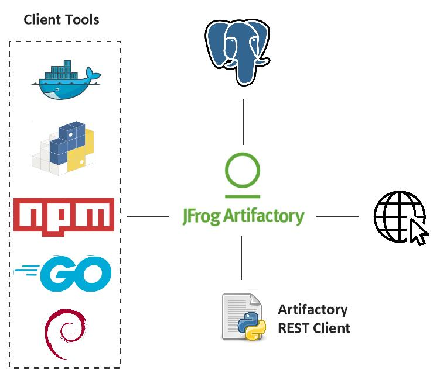
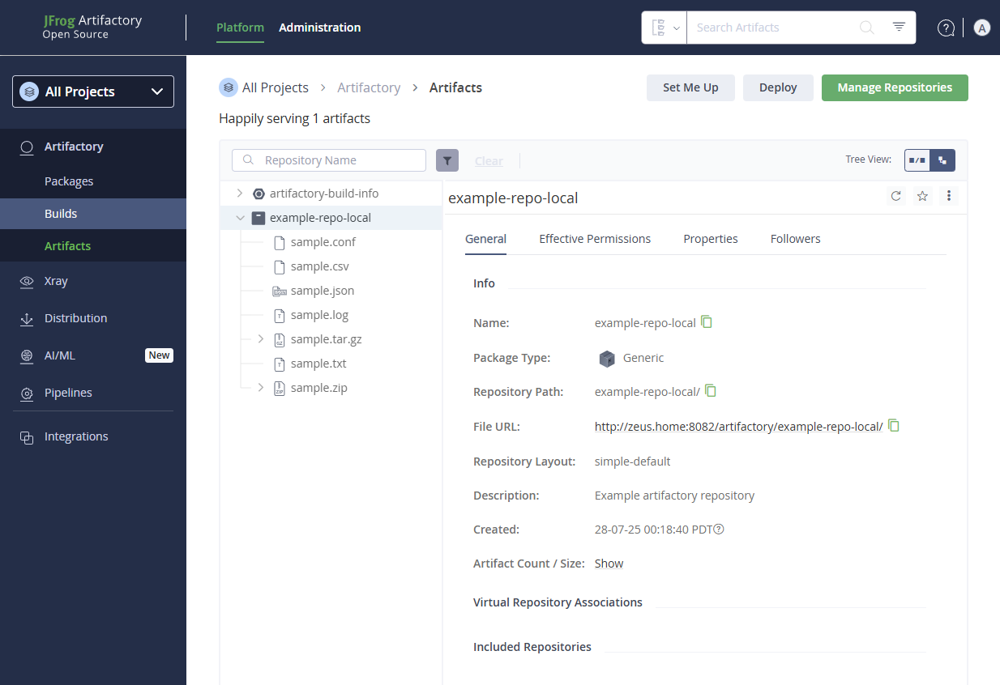

# Cache-Forge

Cache-Forge is a centralized caching layer for software artifacts, package dependencies, and container images. It sits between your internal clients and public registries (PyPI, npm, Docker Hub, etc.), so that every dependency is fetched from the Internet only once and then served locally on subsequent requests.

**Why use it?**

- **Saves bandwidth** — repeated downloads are served from the local cache.
- **Speeds up builds** — cached artifacts are available instantly.
- **Improves reliability** — builds succeed even when upstream registries are rate-limited, slow, or offline.
- **Ensures consistency** — every machine in the lab resolves the same artifact versions.

## System Architecture



Cache-Forge is built on [JFrog Artifactory OSS](https://jfrog.com/artifactory/), deployed as a containerized service. The stack has two main components:

| Component           | Role           |
|---------------------|----------------|
| **Artifactory OSS** | Caches and serves artifacts. Clients point to Artifactory instead of public registries. |
| **PostgreSQL**      | Stores Artifactory metadata (artifact relationships, checksums, repository configs, permissions, and build info). |

> **Note:** Artifactory OSS supports Maven, Gradle, Ivy, and SBT repositories.
> PyPI, npm, Go, Docker, and other modern formats require a **Pro** license.
> See [Artifactory Overview](./ARTIFACTORY.md) for more details on Artifactory configuration.

### How It Works

1. A client tool (pip, npm, docker, etc.) requests a package from Artifactory.
2. On the **first request**, Artifactory fetches the package from the upstream registry and stores a local copy.
3. On **subsequent requests**, Artifactory serves the package directly from cache — no Internet access needed.

Binary artifacts are stored on persistent Docker volumes, while metadata lives in PostgreSQL. This separation ensures that both artifact contents and their metadata survive container restarts, crashes, and upgrades.

### Why PostgreSQL Instead of the Default Database?

Artifactory uses PostgreSQL internally to store its metadata — you never interact with PostgreSQL directly. Artifactory ships with an embedded Derby database that works for quick demos, but Derby is file-based and lacks crash resilience — a poor fit for containers where the file system can be volatile. PostgreSQL provides a fully transactional, production-grade database engine suitable for long-term use. The connection is configured automatically through environment variables in `docker-compose.yml`.

## Getting Started

### 1. Start the Services

```bash
docker compose up -d
```

This launches both the Artifactory and PostgreSQL containers in the background.

### 2. Access the Web UI

Wait for the Artifactory container to finish starting, then open the web UI to complete the initial setup wizard:

```
http://localhost:8082
```

### 3. Verify the REST API

Confirm that Artifactory is running by querying the version endpoint:

```bash
# Using basic authentication
curl -u <username>:<password> http://localhost:8081/artifactory/api/system/version

# Using an access token
curl -H "Authorization: Bearer <your_token>" http://localhost:8081/artifactory/api/system/version
```

## Python Utilities

### Artifactory API Wrapper

The [`Artifactory_API`](./artifactory_api.py) class is a Python wrapper around the JFrog Artifactory REST API. It supports operations such as:

- Listing repositories and directory contents
- Uploading and downloading files
- Retrieving artifact metadata and download statistics
- Checking file existence and managing directories

This class is designed for automation and scripting, making it easy to integrate Artifactory into CI/CD pipelines or local tooling.

### Example Script

The [`main.py`](./main.py) script demonstrates how to connect to Artifactory, upload sample files, and list repository contents — useful for verifying your setup or populating a repository automatically.

```bash
export ARTIFACTORY_TOKEN=<your_token>
python main.py
```


